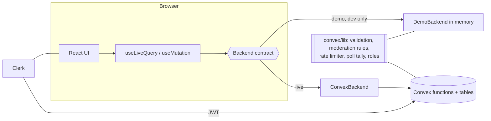

# Quorum

[Português (Brasil)](README.pt-BR.md)

Live Q&A and polling for events: join codes, realtime upvotes, live polls, a moderation queue, a presenter screen, presence and anti-spam limits, on React, Vite, Convex and Clerk.

[](https://github.com/FrancisWorld/quorum/actions/workflows/ci.yml)
[](LICENSE)

> **Read this first:** the live stack (a real Convex deployment and a real Clerk application) was **never exercised** while building this project. Everything below was verified with convex-test, an in-memory demo backend, Vitest, Testing Library and Playwright. See [Limitations](#limitations).

## Why it exists / what is hard about it

A Q&A tool looks simple until a room of 200 people uses it at once. The interesting parts:

- **One vote per identity, transactionally.** `questions.setVote` is declarative (`voted: true|false`), not a toggle, so retries and double clicks are idempotent. The unique-row lookup and the denormalised counter update share one Convex transaction.
- **Permissions that cannot be skipped.** Every function resolves the caller through one helper. Creating a room or joining by code only requires a signed-in identity; every other function also checks room membership and a role permission. Non-members get the same `NOT_FOUND` as a missing room, so ids cannot be probed.
- **Moderation as a state machine.** `pending, approved, answered, rejected` with an explicit transition table; the audience sees held questions only if they wrote them.
- **Rate limits that survive failure.** Token buckets live in the database. Throwing mutations roll back their token (a refused duplicate costs nothing), but join-by-code returns a result instead of throwing so *failed guesses stay counted*.
- **Offline demo that cannot reach production.** Demo mode swaps Clerk and Convex for personas and an in-memory backend. It fails the production build, is tree-shaken out of the bundle (checked by a script), and refuses to start at runtime when `PROD` is true.

## Architecture



The UI only knows the `Backend` interface in `src/backend/contract.ts`. Business rules live in pure modules under `convex/lib/` and are shared by the Convex functions and the demo backend. `tests/app/conformance.test.ts` runs one specification against both implementations.

Data model (`convex/schema.ts`): `rooms`, `members`, `questions`, `upvotes`, `polls`, `pollVotes`, `presence`, `rateLimits`, each with the indexes its queries use (for example `by_question_voter`, `by_room_status_votes`, `by_room_seen`). No query scans a table.

## Quickstart

```bash
npm install
npm run dev:demo        # offline demo at http://localhost:5173, no keys
```

Pick a persona; join code `EVENT7` is a seeded, moderated room. Switch persona from the header to see the participant, moderator and host views.

Verification commands (all run for this README):

```bash
npm run lint
npm run typecheck
npm test                # 131 tests
npm run test:coverage
npm run build && npm run check:bundle
npm run test:e2e        # one Playwright smoke test (starts the demo dev server)
docker compose up --build
```

Real output:

```text
$ npm test
 Test Files  14 passed (14)
      Tests  131 passed (131)

$ npm run check:bundle
Production bundle is free of demo code.

$ VITE_APP_MODE=demo npm run build
DemoModeInProductionError: VITE_APP_MODE=demo is not allowed in a production build. ...

$ npm run test:e2e
  ✓  1 [chromium] › e2e/smoke.spec.ts:3:1 › a moderated question travels from participant to presenter screen (1.4s)
```

Coverage (v8, Apple Silicon laptop, 8 GB): 97.0% statements, 89.0% branches, 98.1% lines over `convex/` and `src/` (Clerk and Convex client glue excluded). The whole unit suite runs in about 2.4 s there.

To run against real services see [docs/SETUP.md](docs/SETUP.md) (unverified checklist).

## Design decisions and trade-offs

- **Declarative votes over toggles.** A toggle is wrong under retries; `setVote(voted)` converges.
- **Denormalised `votes` counter.** Reads are one index range; the cost is that vote writes contend on the question document. Convex serialises conflicting transactions, which is correct but would be the first hotspot for a very popular question.
- **Poll tallies are computed on read** from `pollVotes` (capped at 5000 per poll) with largest-remainder rounding, so percentages always sum to 100. Poll votes are final once cast.
- **Presence is heartbeat rows** with a 45 s TTL and a cron prune. A query only re-runs when data changes, so counts expire on the next heartbeat from anyone, not on a timer.
- **Anonymous means anonymous**, moderators included. The author is stored for abuse handling at the database level only.
- **Demo backend duplicates control flow**, not rules: shared pure modules plus a conformance suite keep the two honest. Mutations run on a snapshot and roll back on throw, mimicking transactions.
- **Offline codegen.** `scripts/generate-convex-types.mjs` builds `convex/_generated` from templates shipped in the `convex` package so typecheck and CI need no deployment. CI fails if the output is stale.
- **ESLint 9, not 10.** `eslint-plugin-jsx-a11y@6.10.2` does not declare support for ESLint 10, so `eslint` is pinned to `^9.39.5` to keep a clean `npm install` without `--legacy-peer-deps`.

## Testing strategy

| Layer | Tool | Covers |
| --- | --- | --- |
| Domain | Vitest | join codes, validators, state machine, visibility, tally rounding, token bucket, mode resolution |
| Convex functions | convex-test (edge runtime) | permissions, tenant isolation, vote races, rate limits and refunds, poll rules, presence TTL, prune cron |
| Conformance | Vitest, both backends | identical behaviour of Convex functions and the demo backend |
| UI | Testing Library | role-specific flows, errors, tab keyboard navigation, theme |
| Server | Vitest | static server: SPA fallback, caching, traversal |
| Smoke | Playwright | question -> moderation -> presenter -> upvote, then a phone-width layout check |

Item to proof: join codes (`convex/lib/joinCode.ts`, `tests/domain/joinCode.test.ts`); one vote per identity (`convex/questions.ts`, `tests/convex/questions.test.ts` voting block); moderation (`convex/lib/moderation.ts`, `questions.test.ts` moderation block); polls (`convex/polls.ts`, `polls.test.ts`); presence (`convex/presence.ts`, `presence.test.ts`); rate limits (`convex/lib/rateLimitDb.ts`, `rooms.test.ts`, `questions.test.ts`); demo mode (`src/config.ts`, `config.test.ts`, `scripts/check-bundle.mjs`).

## Limitations

- **Live Convex and Clerk were not exercised.** No deployment or account was created. Real OCC conflict handling, JWT validation and reactive subscriptions are trusted from the platform, not tested here. convex-test runs mutations without simulating optimistic-concurrency retries, so the race tests prove idempotent logic and counter invariants, not the platform's serialisation.
- `convex/_generated` is produced offline and will be replaced by `npx convex dev` output.
- The demo keeps data in memory for one tab; nothing syncs across tabs.
- Presenter view is read-only. There is no export, no Q&A threading, and poll votes cannot be changed.
- The Docker image serves a static build; `VITE_*` values are baked in at build time. Docker builds were run with the classic builder because BuildKit's buildx plugin is not installed on the author's machine.
- No load or performance benchmarks were run.

## License

MIT, see [LICENSE](LICENSE).

Built by [Chico Oliveira](https://github.com/FrancisWorld)
