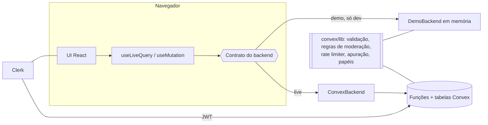

# Quorum

[English](README.md)

Perguntas e enquetes ao vivo para eventos: códigos de sala, upvotes em tempo real, enquetes, fila de moderação, tela do apresentador, presença e limites anti-spam, com React, Vite, Convex e Clerk.

[](https://github.com/FrancisWorld/quorum/actions/workflows/ci.yml)
[](LICENSE)

> **Leia primeiro:** a stack real (um deployment Convex e uma aplicação Clerk de verdade) **nunca foi exercitada** na construção deste projeto. Tudo foi verificado com convex-test, um backend de demonstração em memória, Vitest, Testing Library e Playwright. Veja [Limitações](#limitações).

## Por que existe / o que é difícil

Um app de perguntas parece simples até 200 pessoas usarem ao mesmo tempo. As partes interessantes:

- **Um voto por identidade, de forma transacional.** `questions.setVote` é declarativo (`voted: true|false`), não um toggle; repetições e cliques duplos são idempotentes. A checagem de unicidade e o contador desnormalizado ficam na mesma transação do Convex.
- **Permissões que não dá para pular.** Toda função resolve o chamador por um único helper. Criar uma sala ou entrar por código exige apenas uma identidade autenticada; todas as outras funções também checam a participação na sala e a permissão do papel. Quem não é membro recebe o mesmo `NOT_FOUND` de uma sala inexistente.
- **Moderação como máquina de estados.** `pending, approved, answered, rejected` com tabela explícita de transições; o público só vê perguntas retidas se forem suas.
- **Limites que sobrevivem a falhas.** Token buckets ficam no banco. Mutações que lançam erro devolvem o token (um duplicado recusado não custa nada), mas entrar por código retorna um resultado em vez de lançar, então *tentativas erradas continuam contadas*.
- **Demo offline que não chega à produção.** O modo demo troca Clerk e Convex por personas e um backend em memória. Ele quebra o build de produção, é removido do bundle (verificado por script) e se recusa a iniciar em runtime quando `PROD` é verdadeiro.

## Arquitetura



A UI conhece apenas a interface `Backend` em `src/backend/contract.ts`. As regras de negócio ficam em módulos puros em `convex/lib/`, compartilhados pelas funções Convex e pelo backend demo. `tests/app/conformance.test.ts` executa a mesma especificação contra as duas implementações.

## Como rodar

```bash
npm install
npm run dev:demo        # demo offline em http://localhost:5173, sem chaves
```

Escolha uma persona; o código `EVENT7` é uma sala de exemplo com moderação. Troque de persona no cabeçalho para ver as visões de participante, moderador e anfitrião.

Comandos de verificação (todos executados):

```bash
npm run lint
npm run typecheck
npm test                # 131 testes
npm run test:coverage
npm run build && npm run check:bundle
npm run test:e2e        # um teste de fumaça com Playwright
docker compose up --build
```

Saída real:

```text
$ npm test
 Test Files  14 passed (14)
      Tests  131 passed (131)

$ npm run check:bundle
Production bundle is free of demo code.

$ VITE_APP_MODE=demo npm run build
DemoModeInProductionError: VITE_APP_MODE=demo is not allowed in a production build. ...
```

Cobertura (v8, notebook Apple Silicon, 8 GB): 97,0% de instruções, 89,0% de ramos, 98,1% de linhas em `convex/` e `src/` (cola do Clerk e do cliente Convex excluída). A suíte unitária leva cerca de 2,4 s.

Para usar serviços reais veja [docs/SETUP.md](docs/SETUP.md) (roteiro não verificado, em inglês).

## Decisões e trade-offs

- **Votos declarativos em vez de toggle:** toggle erra sob retentativas; `setVote(voted)` converge.
- **Contador `votes` desnormalizado:** leitura em uma faixa de índice; em troca, votos disputam o mesmo documento. O Convex serializa transações conflitantes, mas seria o primeiro ponto quente em uma pergunta muito popular.
- **Apuração de enquetes na leitura**, com arredondamento por maiores restos para somar sempre 100%. Voto em enquete é definitivo.
- **Presença por heartbeat** com TTL de 45 s e limpeza por cron. Uma query só reexecuta quando há mudança de dados.
- **Anônimo é anônimo**, inclusive para moderadores.
- **O backend demo duplica o fluxo, não as regras:** módulos puros compartilhados mais a suíte de conformidade.
- **Codegen offline** por `scripts/generate-convex-types.mjs`; o CI falha se estiver desatualizado.
- **ESLint 9, não 10:** `eslint-plugin-jsx-a11y@6.10.2` não declara suporte ao ESLint 10; por isso `eslint` fica em `^9.39.5`, evitando `--legacy-peer-deps`.

## Estratégia de testes

Domínio (Vitest), funções Convex com convex-test (permissões, isolamento, corridas de voto, limites, enquetes, presença), conformidade entre os dois backends, UI com Testing Library, servidor estático e um teste de fumaça Playwright (pergunta, moderação, apresentador, upvote e layout de celular).

## Limitações

- **Convex e Clerk reais não foram exercitados.** Nenhum deployment ou conta foi criado. Conflitos otimistas reais, validação de JWT e subscriptions reativas são confiados à plataforma. O convex-test não simula retentativas por conflito; os testes de corrida provam lógica idempotente e invariantes do contador, não a serialização da plataforma.
- `convex/_generated` é gerado offline e será substituído pela saída de `npx convex dev`.
- A demo guarda dados em memória, em uma aba.
- Tela do apresentador somente leitura; sem exportação nem threads; votos de enquete não mudam.
- Imagem Docker estática; valores `VITE_*` entram no build. Os builds Docker usaram o builder clássico porque o plugin buildx não está instalado na máquina do autor.
- Nenhum benchmark de carga foi executado.

## Licença

MIT, veja [LICENSE](LICENSE).

Built by [Chico Oliveira](https://github.com/FrancisWorld)
